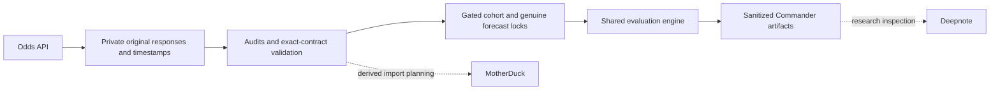

# PRIME architecture inventory for independent advisor review — October18

This is a sanitized description of existing components, not an architecture change or a claim that the separate Software Architecture GPT has reviewed them. Full source-backed inventory and permissions/trust details remain private at research/architecture/2026-10-18-review/ in -NFL-Prop-Odds-Data, merged in PR11. Advisor access is not assumed.

Private evidence repository: jamesddestefano-ui/-NFL-Prop-Odds-Data. Public research/governance and sanitized handoffs: jamesddestefano-ui/NFL-Prop-Bets. Python/unittest/GitHub Actions. Research requirements use bounded version ranges for DuckDB, SciPy, statsmodels, nflreadpy, NumPy and pandas; jsonschema4.26.0 is pinned. Ranges are not a complete environment lock; CI environment records support reproduction.

The cohort/forecast path is gated and currently lacks a valid prospective cohort/model pair. The diagram does not claim that an evaluation occurred or that every hosted integration is an unattended worker.

## Components and integrations

- The Odds API: primary sportsbook source; actual source/HTTP receipt times, original SHA256, exact book/player/game/market/line/sides/prices, quota headers, reserve and dedup safeguards. API quotes do not establish NJ wager availability.
- FantasyPros PublicAPIv2: separate research identity/injury/projection adapter. One authenticated news check succeeded; quotas/other endpoint permissions remain unverified; routine ingestion is disabled. Projections are not official results.
- nflreadpy/nflverse: historical statistics and roster/schedule candidates; canonical matching still requires independent source review.
- Official NFL/team sources: retained kickoff evidence and reviewed final-statistic intake; source hashes authenticate bytes, not all source truth. Future results are never assumed.
- Shared evaluation: three-way Brier/log loss, push treatment, calibration, identical-contract market comparisons, exclusions/missingness, clustered uncertainty and hash-pinned reproducibility. Models remain MODEL_SUSPECT/bet_eligible=false. One slate/game cannot prove predictive superiority.
- GitHub: immutable-head/server-time receipt checks, content fingerprints, append-only application writes, artifacts and durable handoffs. Server possession of bytes does not prove external model authorship or independent operator participation.
- MotherDuck/DuckDB: derived projections/local import planning. Successful preflight does not prove unattended cloud uploads.
- Deepnote: prior hosted readiness/mount evidence exists; inspection uses shared scoring outputs. No current machine uptime or continuous worker is inferred.
- Claude: no authorized usable route or genuine independent response verified; another internal model/agent is not a substitute.

## Active workflow definitions

GitHub reports35 active definitions. “Active” does not mean runtime ingestion enabled, successful pilot execution or verified data. The full private inventory preserves definitions/hashes and exact permission/concurrency graph.

| ID | Workflow | Triggers |
|---|---|---|
|387230879|PRIME v1 Real-Data Forecast Batch|workflow_dispatch, schedule|
|387229191|PRIME Player-Specific Baseline v1 Tests|workflow_dispatch, push|
|387719444|PRIME duplicate-side synthetic quarantine regression|workflow_dispatch, push|
|387197826|PRIME Experimental Player Forecast Batch|workflow_dispatch|
|387211611|PRIME Experimental Market Evaluation|workflow_dispatch|
|388082391|FantasyPros Gated Manual NFL Research Capture|workflow_dispatch|
|388069324|FantasyPros Isolated Contract and Safety Validation|pull_request, push, workflow_dispatch|
|387169622|PRIME Sunday 1 PM Cohort Freeze|workflow_dispatch, schedule|
|387733312|PRIME 2025 Historical Backtest (Research Only)|workflow_dispatch, push|
|387230595|PRIME 2025 Player History Ingestion|workflow_dispatch|
|388583942|PRIME October19 Monday Prospective Controls|workflow_dispatch, workflow_run, schedule|
|388583944|PRIME Monday Independent Publication Receipt|workflow_dispatch|
|387362447|PRIME MotherDuck Import Preflight|workflow_dispatch, push|
|387182451|PRIME NFL Baseline Integration Validation|workflow_dispatch|
|387180437|PRIME nflreadpy Historical Data Validation|workflow_dispatch|
|387132640|PRIME NFL Odds API Collector v2|workflow_dispatch, schedule|
|387148673|PRIME Private Consensus Validation|workflow_dispatch|
|387142188|PRIME Private Odds Data Quality Audit|workflow_dispatch, workflow_run, push, schedule|
|387145432|PRIME Private Pair and Market Diagnostics|workflow_dispatch|
|387996454|PRIME Phase 2 Validation and Learning|pull_request, push, workflow_dispatch, schedule|
|388044699|PRIME October 18 Pilot Lifecycle|push, workflow_run, workflow_dispatch, schedule|
|388044702|PRIME Official NFL Outcome Source Capture|workflow_dispatch|
|388044703|PRIME Independent Pilot Publication Receipt|workflow_dispatch|
|388034622|PRIME Prospective Pilot Safety Validation|pull_request, push, workflow_dispatch|
|387188231|PRIME Player Identity Crosswalk Audit|workflow_dispatch|
|387213299|PRIME Post-Kickoff Closing Evaluation|workflow_dispatch, schedule|
|387226938|PRIME Closing and Safety Tests|workflow_dispatch, push|
|387260126|PRIME Research Continuous Validation|push, workflow_dispatch|
|387154698|PRIME Quote Persistence Audit|workflow_dispatch|
|387175674|PRIME Research Stack Validation|workflow_dispatch|
|387191419|PRIME Weekly Roster Evidence Validation|workflow_dispatch|
|387196406|PRIME Team Event Identity Review|workflow_dispatch|
|387236783|PRIME v1 Invalid-Input Diagnostics|workflow_dispatch|
|387240442|PRIME Record-Level v1 Diagnostics|workflow_dispatch, push|
|387983099|Verified Historical Evaluation (Research Only)|pull_request, push, workflow_dispatch|

Core graph: collector completion → audits and offline pilot readiness; prospective publication receivers → source/provenance-gated state checks; reviewed inputs → shared historical/Phase2 evaluation and content-deduplicated artifacts. Monday controls have a separate context and disabled activation policy. OriginalOctober18 remains PILOT_INCOMPLETE.

## Independent advisor questions and known limitations

1. What qualifies as a genuinely independent observer/fallback when GitHub schedules can be absent or late? More same-platform scheduled workflows do not prove independent availability.
2. Review append-only/branch/receipt/archive trust, artifact retention, least-privilege workflow permissions and secret scoping using the private inventory. Do not assume server-enforced immutable storage or permanent evidence retention.
3. Monday freeze/submission/receipt/readiness contexts exist, but outcome/evaluation orchestration still has October18 paths. Review a context adapter or explicit reviewed Phase2 bundle procedure before calling Monday end-to-end integration complete. No speculative implementation is made ahead of this review.
4. Review settlement extensibility: INTEGER_PUSH_NO_VOID is supported by a validator but not established for every book/market. DNP/void/overtime/corrections need sourced review or exclusion.
5. Evaluate candidate identity confidence, input availability, clock/source trust, dependency reproducibility and numerical/evaluation assumptions. Hashes and signed-in accounts alone do not prove operator independence, model authorship or provider correctness.
6. Keep data separation and spending boundaries: no wagers, account actions, credentials, automatic promotion or additional purchases; no frequency expansion under unverified key-rotation constraints.

Please provide review recommendations through GitHub before architecture implementation. No completed external advisor review is claimed.
